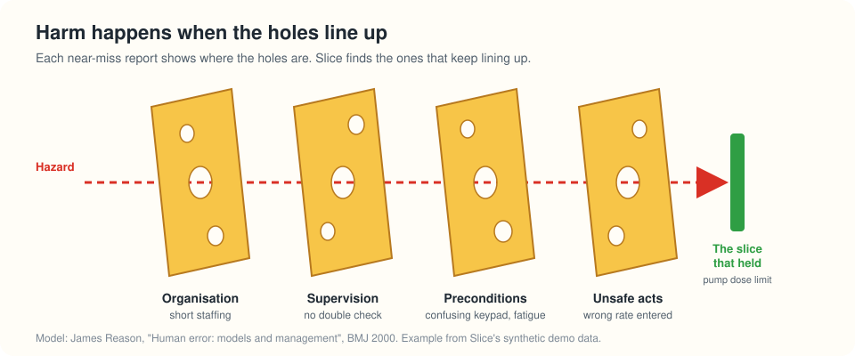
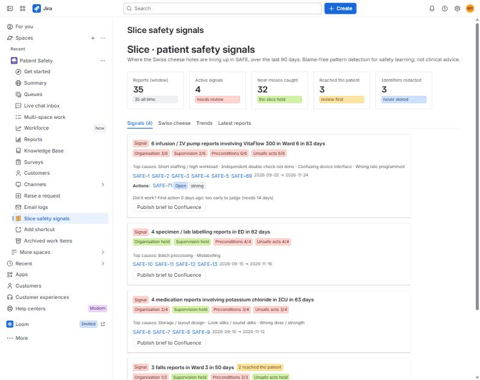
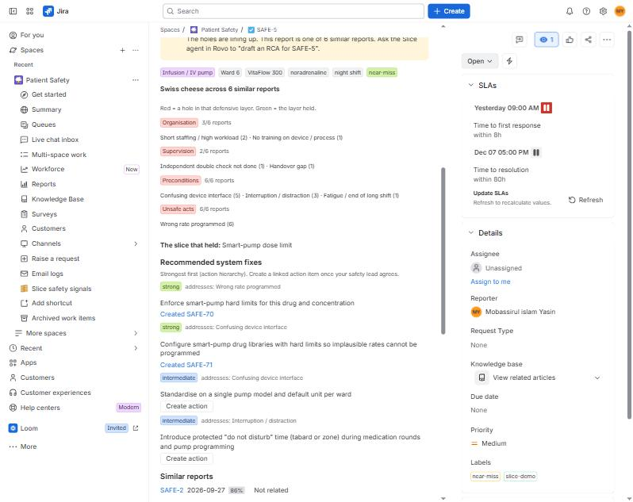
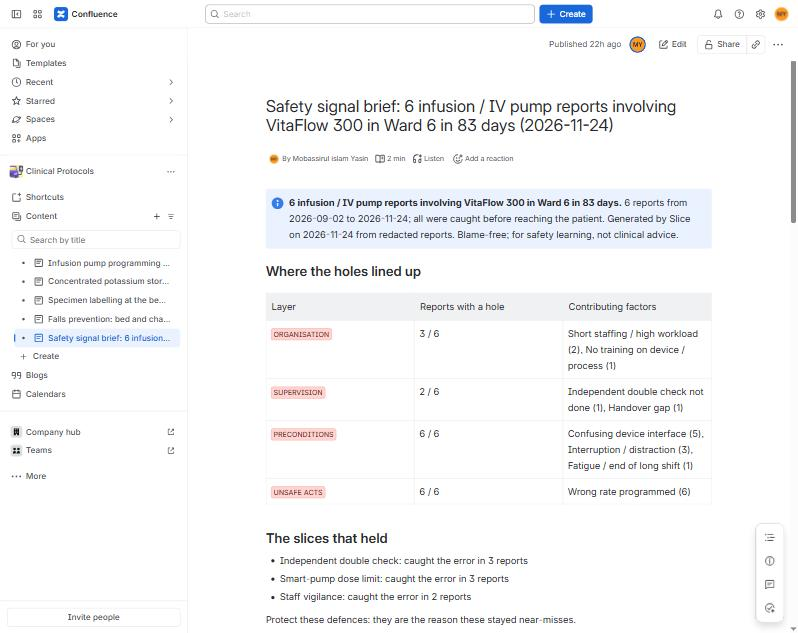
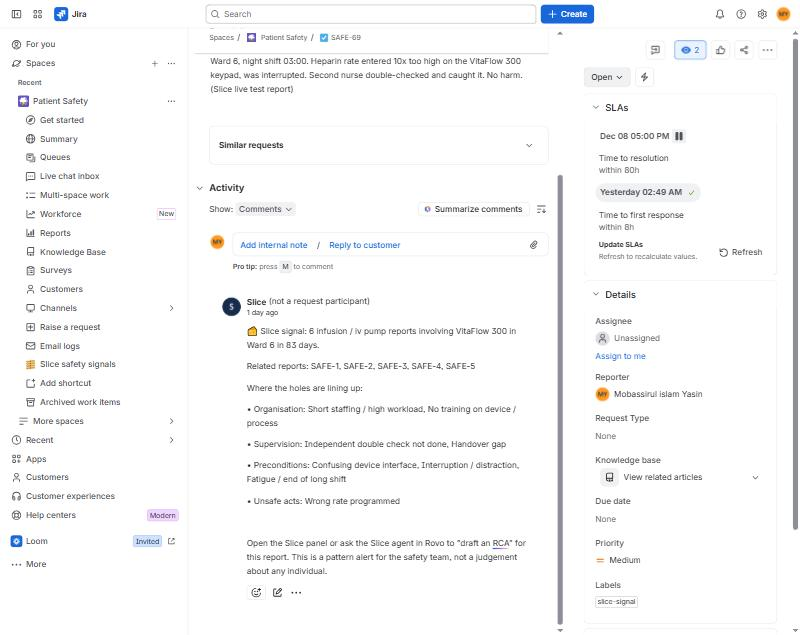
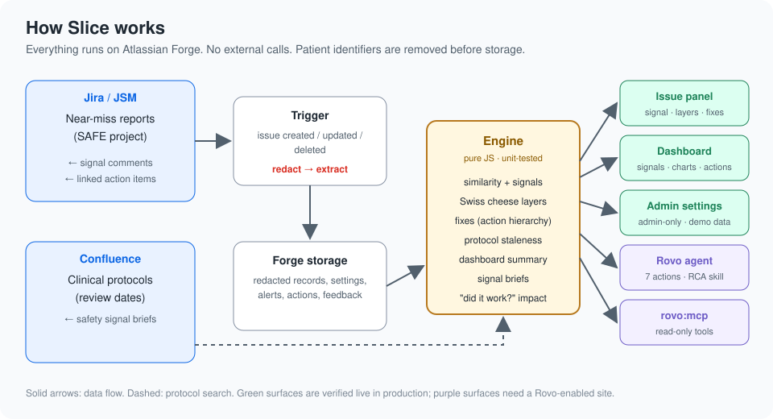

<p align="center"></p>

<h1 align="center">Slice</h1>

<p align="center"><b>Hospital near-misses, connected before the holes line up.</b><br>
A patient-safety learning app for Jira, Confluence and Rovo, built on Atlassian Forge.</p>

<p align="center">
  <a href="https://github.com/yasinDoc/slice/actions/workflows/test.yml"></a>
  
  
  
  <a href="LICENSE"></a>
</p>

<p align="center">
  <a href="#try-it-in-5-minutes">Try it</a> ·
  <a href="#what-slice-does">Features</a> ·
  <a href="#screenshots">Screenshots</a> ·
  <a href="#how-it-works">How it works</a> ·
  <a href="#accuracy">Accuracy</a> ·
  <a href="docs/DESIGN.md">Design</a> ·
  <a href="PRIVACY.md">Privacy</a> ·
  <a href="docs/SUBMISSION.md">Codegeist kit</a>
</p>

---

## The problem

Most harm to patients in hospital shows up first as a **near-miss**: a wrong pump rate caught by a
second nurse, a mislabelled blood tube rejected by the lab. Hospitals ask staff to report these, but
each report is reviewed on its own. When the same failure finally reaches a patient, the
investigation finds the earlier warnings, filed weeks apart in different words. The knowledge was
there. Nothing connected it.

<p align="center"></p>

James Reason's **Swiss cheese model** explains why: every safety system is a stack of defensive
layers, each with holes, and harm happens when the holes line up. **Slice reads every near-miss
report, works out which layers had holes, and tells you when the same holes keep appearing.**

> 🧀 **Slice signal: 6 infusion / IV pump reports involving VitaFlow 300 in Ward 6 in 83 days.**
> Preconditions 6/6 (confusing device interface, interruption, fatigue) · Unsafe acts 6/6 (wrong rate).
> The slice that held: smart-pump dose limit. Related protocol: last reviewed **56 months ago**.
> Strongest fix: *enforce smart-pump hard limits for this drug and concentration*. **[Create action]**

*A real signal from Slice's synthetic demo data, as shown in Jira.*

## What Slice does

| | |
|---|---|
| 🔒 **Redacts first** | Patient names, record numbers, dates of birth, phone numbers, emails and bed numbers are removed **before** anything is stored |
| 🏷️ **Understands each report** | Category, ward, device model, drug, shift, outcome (near-miss, no-harm, harm), contributing factors, and the defence that caught the error. Understands negation ("staff were **not** tired") and clinical shorthand ("pt") |
| 🧀 **Slices it** | Maps contributing factors onto Reason's four layers: organisation, supervision, preconditions, unsafe acts |
| 🔗 **Connects the dots** | Explainable similarity (*"same device model · same ward · night shift"*) and automatic **signals** for recurring patterns |
| 🔔 **Alerts in context** | When a new report joins a pattern, Slice comments on it once and labels it `slice-signal` |
| 📄 **Checks protocols** | Finds the relevant Confluence protocols and flags any not reviewed in 24 months |
| 🛠️ **Recommends fixes** | System-level fixes ranked by the safety action hierarchy: strong (redesign) before intermediate (checks) before weak (training) |
| ✅ **Turns them into work** | One click creates a linked Jira action item, after a human agrees |
| 🔁 **Closes the loop** | Each signal tracks its action items, their live status, and **did it work?**: recurrence since the first action vs the same period before |
| 📝 **Briefs the committee** | One click publishes a Confluence **safety signal brief**: layers, defences that held, ranked fixes, stale protocols, a timeline linked to Jira, and a decision checklist |
| 📊 **Shows the big picture** | A project dashboard: active signals, Swiss cheese profile, top causes, defences that held, weekly trend, latest reports |
| 🤖 **Talks via Rovo** | On Rovo-enabled sites: a Slice agent with seven actions and a reusable RCA skill, plus `rovo:mcp` tools |

### Where you find it in Atlassian

| Surface | What you see |
|---|---|
| **Issue panel** on every safety report | Signal banner, Swiss cheese layers, recommended fixes with **Create action**, similar reports with reasons, protocol staleness |
| **Slice safety signals** in the project sidebar | The dashboard: tiles, signal cards with actions, *did it work?* and **Publish brief to Confluence**, charts, latest reports |
| **Comments** on new reports | 🧀 signal alert with related reports and the layers that keep failing |
| **Confluence** | Signal briefs and the *Clinical Protocols* space |
| **Settings** (Administration → Connected apps → Slice → ⋯ → Configure) | Safety projects, signal threshold, look-back window, comments on/off, **Load demo data** |

## Screenshots

*From a live production install, using the synthetic demo data.*

<table>
  <tr>
    <td width="50%"><br><sub><b>Dashboard:</b> 4 signals, layers with holes, tracked actions and <i>did it work?</i></sub></td>
    <td width="50%"><br><sub><b>Issue panel:</b> layers, the slice that held, fixes ranked by strength, linked actions</sub></td>
  </tr>
  <tr>
    <td width="50%"><br><sub><b>Confluence brief:</b> one click, ready for the safety committee</sub></td>
    <td width="50%"><br><sub><b>Alert in context:</b> a new report joins the pattern, and Slice says so without blaming anyone</sub></td>
  </tr>
</table>

## Try it in 5 minutes

1. Install Slice on a site with **Jira** (or Jira Service Management) and **Confluence**.
2. Create a Jira project with the key **`SAFE`**.
3. Open **Slice safety signals** in the project sidebar and click **Load demo data** (Jira admins).
   It creates 34 synthetic near-miss reports and a *Clinical Protocols* Confluence space, then
   indexes everything. Clicking twice never duplicates anything. No API token or terminal needed.
4. The dashboard shows **4 signals**: pump errors on Ward 6, look-alike potassium in ICU, specimen
   labelling in the emergency department, and falls on Ward 3.
5. Open **SAFE-5**. On a fresh install, click the cheese-slices icon above the description once to add the panel.
   Try **Create action** on the strongest fix.
6. On the dashboard, click **Publish brief to Confluence** on the pump signal and open the page.
7. Create a new report: *"VitaFlow 300 rate entered wrong again. Ward 6, night shift 03:00. Heparin
   rate entered 10x too high on the keypad, was interrupted. Second nurse double-checked and caught
   it."* Within 1–3 minutes Slice comments 🧀 on it.
8. On a Rovo-enabled site, pick the **Slice** agent in Rovo chat and ask *"What safety signals are
   emerging this month?"* or *"Draft an RCA for SAFE-5"*.

## How it works

<p align="center"></p>

- **A deterministic, explainable engine** ([`src/engine/`](src/engine)) does the analysis: a safety
  lexicon, redaction, weighted similarity (category, device, location, drug, factors, shift, text),
  signal detection, Swiss cheese profiles, fixes ranked by the action hierarchy, protocol staleness,
  briefs and before/after impact. Every match shows its reasons, so a safety lead can check it or
  disagree with it.
- **Useful without AI, better with it.** Every outcome above works with no LLM. On Rovo-enabled
  sites, the agent adds conversation. Its [prompt](prompts/slice-agent.md) and
  [skill](skills/safety-rca/SKILL.md) enforce blame-free, cite-every-claim answers and forbid clinical advice.
- **Permission-aware.** Users only ever see reports they can already open in Jira. Settings and demo
  data are admin-only.

Full details: [docs/DESIGN.md](docs/DESIGN.md) (data model, scoring, signal rules).

## Accuracy

Slice's extraction is measured on a **held-out evaluation set** ([`tests/eval-set.js`](tests/eval-set.js)):
30 near-miss reports written independently of the demo data, in varied wording and shorthand, labelled
the way a patient-safety reviewer would. CI fails if accuracy drops below the thresholds.

| Measure | Result | Threshold |
|---|---|---|
| Incident category | **97%** | ≥ 90% |
| Location | **100%** | ≥ 90% |
| Outcome (near-miss / no-harm / harm) | **100%** | ≥ 90% |
| Contributing factors and defences found | **100%** | ≥ 85% |
| Negated phrases wrongly counted | **0** | must be 0 |

Building the set found real weaknesses, and each one is now fixed: drug names did not count towards
*medication*, *"no double check was done"* was read as a defence that held, *"a CT showing a bleed"*
was read as harm to the patient, and falls without injury were not separated from near-misses.
The one remaining disagreement (a misheard verbal order filed as *medication* rather than
*communication*) is a judgement call, so the engine was left as it is rather than tuned to the test.

## Principles

- **Blame-free.** Slice looks at systems, never individuals. It never ranks or names staff.
- **Identifiers never stored.** Redaction runs before storage. No account IDs, names or emails are kept.
- **Runs on Atlassian.** No external calls, no third parties, no tracking. See [PRIVACY.md](PRIVACY.md).
- **Humans decide.** Slice drafts and suggests. People approve every action.
- **Not clinical decision support.** Slice is for safety learning and quality improvement only.

## For developers

Requirements: **Node 22.3+** and, to deploy, the [Forge CLI](https://developer.atlassian.com/platform/forge/getting-started/).

```bash
npm install
npm test         # 47 tests: engine, held-out accuracy, Forge integration (mocked Jira, Confluence, KVS), demo loader
npm run demo     # run the engine on the demo data offline: signals plus a sample RCA
```

Deploy your own copy:

```bash
forge register   # writes your own app.id into manifest.yml
forge deploy
forge install --product jira --site your-site.atlassian.net
forge install --product confluence --site your-site.atlassian.net
```

<details>
<summary>Forge modules</summary>

| Module | Purpose |
|---|---|
| `jira:issuePanel` | Per-report analysis, fixes and actions |
| `jira:projectPage` | Safety signals dashboard |
| `jira:adminPage` | Settings (admin-only, validated) and one-click demo data |
| `trigger` | Index on issue created/updated; forget on delete; one alert per report per signal |
| `rovo:agent` | Slice agent |
| `action` ×7 | `find-similar-reports`, `get-safety-signals`, `explain-slices`, `find-protocols`, `draft-rca`, `create-safety-action`, `publish-signal-brief` |
| `rovo:skill` | `safety-rca`: reusable RCA write-up method |
| `rovo:mcp` | The five read-only tools for external MCP clients |

</details>

<details>
<summary>Project layout</summary>

```
manifest.yml            Forge modules and permissions
src/engine/             Pure, unit-tested logic (redaction, lexicon, similarity, signals,
                        RCA, dashboard, briefs, impact)
src/analysis.js         Glue between Atlassian data, storage and the engine
src/actions.js          Rovo action handlers
src/triggers.js         Issue event handler (index, forget, signal alert)
src/resolvers.js        Backend for the panel, dashboard and settings
src/demo.js             One-click demo data and Confluence publishing (Confluence v2 API)
src/demo-data.js        Synthetic reports and protocols (fictional devices, no real patients)
src/frontend/           index.jsx (panel), dashboard.jsx (project page), settings.jsx (admin)
prompts/, skills/       Rovo agent prompt and RCA skill
scripts/                demo.js (offline), seed.js and remove-duplicates.js (scripted setup)
tests/                  engine, held-out accuracy (eval-set.js), Forge integration and demo-loader tests
```

</details>

## Limitations

- **Rovo was not available on our test sites**, so the agent and `rovo:mcp` are covered by
  automated tests but were not demonstrated live. Everything else is verified on a live production install.
- Redaction is pattern-based. It catches common identifiers but cannot guarantee every one, so local
  policy should still keep patient details out of near-miss reports.
- The lexicon is English. The held-out evaluation shows it generalises beyond the demo data, but
  real deployments would still extend it with local terms, devices and drugs.
- *Did it work?* compares simple counts over equal windows. It is a prompt for discussion, not a
  statistical test.

## Roadmap

- Assign a report to Slice in Jira and let it run the investigation (`rovo:agentConnector`)
- Teamwork Graph links between reports, protocols, wards and actions
- Harm-weighted trends and significance testing for the before/after check
- A configurable lexicon editor for local devices, drugs and wards

## Disclaimer

Slice supports patient-safety learning and quality improvement. It is not a medical device and does
not provide clinical advice. All demo data is synthetic; *VitaFlow 300* and *LabelJet 2* are
fictional products.

## License

[MIT](LICENSE) © 2026 Mobassirul islam Yasin. Built for Atlassian Codegeist 2026.
