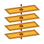

<p align="center"></p>

<h1 align="center">Slice</h1>

<p align="center"><b>Hospital near-misses, connected before the holes line up.</b><br>
A patient-safety learning app for Jira, Confluence and Rovo, built on Atlassian Forge.</p>

---

Most harm to patients in hospital shows up first as a **near-miss**: an error caught in time.
Staff report them, but each report is reviewed alone. When the same failure finally harms
someone, the investigation finds the earlier warnings, filed weeks apart in different words.

James Reason's **Swiss cheese model** says every safety system is a stack of defensive layers.
Each has holes, and harm happens when the holes line up. **Slice reads every near-miss report,
works out which layers had holes, and tells you when the same holes keep appearing.**

> 🧀 *Slice signal: 6 infusion / IV pump reports involving VitaFlow 300 in Ward 6 in 83 days.*
> *Preconditions 6/6 (confusing device interface, interruption, fatigue) · Unsafe acts 6/6 (wrong rate).*
> *The slice that held: smart-pump dose limit. Related protocol: last reviewed 56 months ago (stale).*
> *Strongest fix: enforce smart-pump hard limits for this drug and concentration. [Create action]*

Codegeist 2026 entry · **Apps for Specialized Industries (healthcare)** · bonus tracks:
**Best Agents** (Rovo agent, actions and skill) and **Best MCP** (`rovo:mcp`).

## What it does

| | |
|---|---|
| 🔒 **Redacts first** | Names, MRNs, DOB, phone numbers, emails and bed numbers are removed before anything is stored |
| 🏷️ **Understands the report** | Category, ward, device model, drug, shift, outcome, contributing factors, and the defence that caught it |
| 🧀 **Slices it** | Maps factors onto Reason's layers: organisation, supervision, preconditions, unsafe acts |
| 🔗 **Connects the dots** | Explainable similarity ("same device model · same ward · night shift") and automatic **signals** |
| 📄 **Checks protocols** | Finds Confluence pages labelled `protocol` and flags any not reviewed in 24 months |
| 🤖 **Drafts the RCA** | The Rovo agent writes a blame-free root cause analysis, with fixes ranked strong → weak |
| 🛠️ **Recommends fixes** | System-level fixes ranked by the safety action hierarchy (strong → intermediate → weak) |
| ✅ **Turns it into work** | One click (after a human agrees) creates a linked Jira action item |
| 📊 **Shows the big picture** | A project dashboard: active signals, Swiss cheese profile, top causes, the slices that held, weekly trend |
| 🔔 **Alerts in context** | When a new report joins a pattern, Slice comments on it once and labels it `slice-signal` |

### Principles
- **Blame-free.** Slice looks at systems, never individuals. The agent refuses to rank staff.
- **No patient data stored.** Only redacted text and facets go into Forge storage.
- **Runs on Atlassian.** No external egress. Pattern detection is deterministic and explainable.
- **Humans decide.** Slice drafts. People approve.
- **Not clinical decision support.** It is for safety learning and quality improvement only.

## Forge modules

| Module | Purpose |
|---|---|
| `rovo:agent` **Slice** | Conversational safety analyst |
| `action` × 6 | `find-similar-reports`, `get-safety-signals`, `explain-slices`, `find-protocols`, `draft-rca`, `create-safety-action` |
| `rovo:skill` **safety-rca** | Reusable RCA write-up method that other agents can use |
| `rovo:mcp` | The five read-only tools, for Claude, Cursor and other MCP clients |
| `jira:issuePanel` (UI Kit) | Signal banner, Swiss cheese layers, recommended fixes with one-click action items, similar reports, protocol staleness |
| `jira:projectPage` (UI Kit) | **Slice safety signals** dashboard: stat tiles, signal cards, charts, latest reports |
| `jira:adminPage` (UI Kit) | Settings (safety projects, signal threshold, look-back window, comments), admin-only, plus **Load demo data** |
| `trigger` | Indexes reports on create, update and delete; comments once per report per signal |

See [docs/DESIGN.md](docs/DESIGN.md) for the architecture, data model and scoring.

## Try the engine in 10 seconds (no Atlassian site needed)

```bash
npm install
npm run demo        # signals plus a sample RCA from 34 synthetic reports
npm test            # 31 tests: engine, Forge integration and demo loader
```

## Install on your Atlassian site

Prerequisites: Node 22, the [Forge CLI](https://developer.atlassian.com/platform/forge/getting-started/)
(`npm i -g @forge/cli`, then `forge login`), and a developer site with Jira, Confluence and Rovo.

```bash
npm install
forge register          # writes your own app.id into manifest.yml
forge deploy
forge install --product jira --site your-site.atlassian.net
forge install --product confluence --site your-site.atlassian.net --upgrade
```

1. Create a Jira project with the key **`SAFE`** (a Service Management project works well), the default safety project.
2. Open the project's **Slice safety signals** page in the sidebar and click **Load demo data** (Jira admins only).
   It creates 34 synthetic near-miss reports and a **Clinical Protocols** Confluence space with 4 protocol pages,
   then indexes everything. It is safe to click twice; nothing is duplicated.
3. Open **SAFE-5** and look at the **Slice · safety signals** panel: the pump signal, the Swiss cheese layers,
   recommended fixes, similar reports and the stale protocol.
4. Create a new report such as *"VitaFlow 300 rate entered wrong again, Ward 6, night shift"* and watch Slice
   comment on it within a minute or two.
5. In Rovo chat, pick the **Slice** agent and ask *"What safety signals are emerging this month?"* or
   *"Draft an RCA for SAFE-5"*.

No API token or terminal is needed for the demo data. For scripted setups there is also `npm run seed`:

```bash
JIRA_BASE_URL=https://your-site.atlassian.net JIRA_EMAIL=you@example.com \
JIRA_API_TOKEN=xxxx SLICE_PROJECT=SAFE npm run seed
```

## Project layout

```
manifest.yml            Forge modules and permissions
src/engine/             Pure, unit-tested logic (redaction, lexicon, similarity, signals, RCA)
src/analysis.js         Glue between Atlassian data, storage and the engine
src/actions.js          Rovo action handlers
src/triggers.js         Issue event handler (index and signal alert)
src/resolvers.js        Backend for the panel, dashboard and settings pages
src/demo.js             One-click demo data loader (Jira bulk create, Confluence v2)
src/frontend/           index.jsx (issue panel), dashboard.jsx (project page), settings.jsx (admin page)
prompts/slice-agent.md  Agent instructions
skills/safety-rca/      Rovo skill
src/demo-data.js        Synthetic reports and protocols (fictional devices, no real patients)
scripts/                demo.js (offline), seed.js and remove-duplicates.js (scripted setup)
tests/                  engine, Forge integration (mocked Jira/Confluence/KVS) and demo-loader tests
```

## Roadmap

- Assignable investigator: assign a report to Slice in Jira (`rovo:agentConnector`)
- A Confluence "Safety signal" page generated per signal
- Teamwork Graph links between reports, protocols, wards and actions
- Before/after view: did a fix reduce repeat reports in that pattern?

## Disclaimer

Slice supports patient-safety learning and quality improvement. It is not a medical device
and does not provide clinical advice. All demo data is synthetic.

## License

MIT
