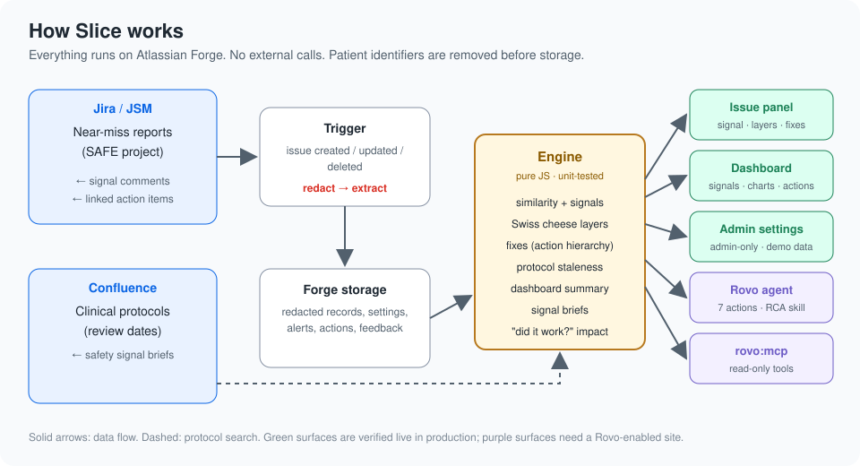

# Slice: design

> Most harm in hospitals shows up first as a near-miss that nobody connected to the others.
> Slice connects them.

## 1. The problem

Hospitals ask staff to report near-misses: errors caught before they reached a patient,
or that caused no harm. Each report is reviewed on its own. When the same failure finally
does harm a patient, the investigation usually finds earlier reports of the same thing.
They were filed in different weeks, by different people, in slightly different words.

James Reason's **Swiss cheese model** explains why. Every safety system is a stack of
defensive layers (the "slices"). Each layer has holes, and harm happens when the holes in
every layer line up. Near-miss reports show where the holes are, but only if someone
reads them side by side.

## 2. What Slice does

| Step | What happens | Where |
|---|---|---|
| **Capture** | Staff file a near-miss as a Jira or JSM work item in the safety project (`SAFE` by default) | Jira / JSM |
| **Protect** | Patient identifiers (names, MRNs, DOB, phone, email, bed numbers) are redacted before anything is stored | `src/engine/redact.js` |
| **Understand** | Each report is turned into facets: category, location, device, drug, shift, contributing factors, and the defence that caught it | `src/engine/extract.js` |
| **Slice** | Contributing factors are mapped onto Reason's four layers: organisation, supervision, preconditions, unsafe acts | `src/engine/lexicon.js` |
| **Connect** | Each new report is compared with the history and grouped into signals ("4th pump-rate error on Ward 6 in 30 days") | `src/engine/similarity.js`, `signals.js` |
| **Check protocols** | Matching Confluence protocols are found and flagged if their review date is more than 24 months old | `src/engine/rca.js` |
| **Recommend** | System-level fixes for the layers with holes, sorted by the action hierarchy (strong → intermediate → weak) | `src/engine/rca.js` (`recommend`) |
| **Act** | After a human agrees, Slice creates a linked Jira action item (panel button or Rovo) | `createAction`, `create-safety-action` |
| **Close the loop** | Each signal tracks its action items, their live status, and recurrence since the first action vs an equal window before | `src/engine/impact.js` |
| **Brief** | A Confluence page per signal: layers, defences, fixes, stale protocols, linked timeline, decision checklist | `src/engine/brief.js`, `publishPage` |
| **Oversee** | Project dashboard: signals, Swiss cheese profile, top causes, defences that held, weekly trend | `jira:projectPage`, `src/engine/dashboard.js` |
| **Converse** *(Rovo sites)* | The Slice agent answers questions and drafts an RCA using the same actions | `rovo:agent`, `rovo:skill`, `action` ×7 |

## 3. Principles

1. **Blame-free.** Slice looks for system causes. It never ranks, scores or names individuals.
   The agent prompt forbids it.
2. **Humans decide.** Slice drafts and suggests. People approve every change. The only
   automatic write is a signal comment with a label, and admins can switch that off.
3. **No patient data stored.** Redaction runs before storage. Only redacted text and
   facets are kept in Forge storage.
4. **Runs on Atlassian.** No external egress. The pattern engine is deterministic and
   explainable, and runs inside Forge. All language generation goes through Rovo.
5. **Not clinical decision support.** Slice supports safety learning and quality
   improvement. It does not advise on the care of individual patients.
6. **Explainable.** Every match shows its reasons ("same device · same ward · night shift").

## 4. Architecture

- **Trigger** (`avi:jira:created|updated|deleted:issue`): fetch the issue, skip Slice's own
  action items (label `slice-action`), redact, extract and store. On delete, drop the record. Then
  check signals and comment once per report per signal.
- **Engine** (`src/engine/*`): pure JavaScript with no Forge imports, unit-tested with `node --test`.
- **Surfaces**: the issue panel, dashboard and settings (UI Kit resolvers), and the Rovo actions,
  all call the same engine, so behaviour is identical everywhere.
- **Permissions**: user-facing results are filtered to issues the current user can open. Settings
  and demo data require the Jira `ADMINISTER` permission. Writes that a user triggers run as that user.

### Data model (KVS)

| Key | Value |
|---|---|
| `report:<ISSUE-KEY>` | `{ key, summary, text, eventDate, category, location, device, deviceModel, drug, shift, outcome, factors[], defences[], tokens[], redactions }`, all redacted |
| `alert:<signalId>` | `{ keys[], count, at }`: reports already alerted for this signal (one comment per report) |
| `settings` | `{ projectKeys: ["SAFE"], commentOnSignal: true, minSignalCount: 3, windowDays: 90 }` |
| `action:<ISSUE-KEY>` | `{ key, from, text, strength, createdAt }`: action items Slice created (excluded from indexing via the `slice-action` label) |
| `feedback:<ISSUE-KEY>` | `{ notRelated[] }`: matches a user marked "not related", hidden for that report |

### Similarity

The score between two reports is a weighted sum (weights in `similarity.js`):

| Facet | Weight |
|---|---|
| category | 0.30 |
| device (model match counts in full; a generic device type counts 60%) | 0.20 |
| location | 0.15 |
| drug | 0.10 |
| contributing factors (Jaccard) | 0.10 |
| shift | 0.05 |
| text (term cosine) | 0.10 |

A report counts as "similar" at a score of 0.45 or more. A **signal** is a group of at least
`minSignalCount` (default 3) reports within the look-back window (default 90 days) that share one of:

- the same **category and location** (e.g. infusion errors on Ward 6)
- the same **category and device model** (e.g. infusion errors on VitaFlow 300)
- the same **drug** (e.g. potassium chloride)

Signals whose reports are a subset of a larger signal are merged into it. Both thresholds are
admin settings.

### Recommendation strength

The strength levels follow the action hierarchy used in safety science (strongest first):

- **Strong:** forcing functions, physical redesign, removing the hazard.
  Examples: separate storage, smart-pump hard limits.
- **Intermediate:** standardisation, checklists, redundancy.
  Examples: an independent double check, barcode scanning.
- **Weak:** training, a new policy, warnings.

Fixes are listed strongest first, and the agent's prompt tells it never to propose weak fixes alone.

## 5. Bonus-prize mapping

| Bonus | Module |
|---|---|
| Best Agents (entered) | `rovo:agent` Slice, seven reusable `action` modules and the `rovo:skill` safety-rca |
| Best MCP (not entered) | `rovo:mcp` is included but could not be verified without Rovo |
| Teamwork Graph | Planned: links reports, protocols, wards and actions in the graph |
| Marketplace | The no-egress, identifier-free design is built with a listing in mind |

## 6. Roadmap

- [x] Engine: redaction, extraction, Swiss cheese layers, similarity, signals, RCA draft
- [x] Forge: trigger indexing, Rovo agent, actions, skill, MCP, issue panel
- [x] Synthetic seed data with deliberate clusters
- [x] Project dashboard, admin settings (admin-only, validated), one-click demo data
- [x] Recommended fixes with one-click linked action items in the panel
- [ ] Assignable investigator (`rovo:agentConnector`, which needs a remote A2A service)
- [x] Confluence "safety signal brief" per signal (dashboard button and Rovo action)
- [ ] Teamwork Graph objects for reports and protocols
- [x] Action tracking per signal with live status and a before/after recurrence check
- [ ] Feedback-driven tuning of similarity weights
